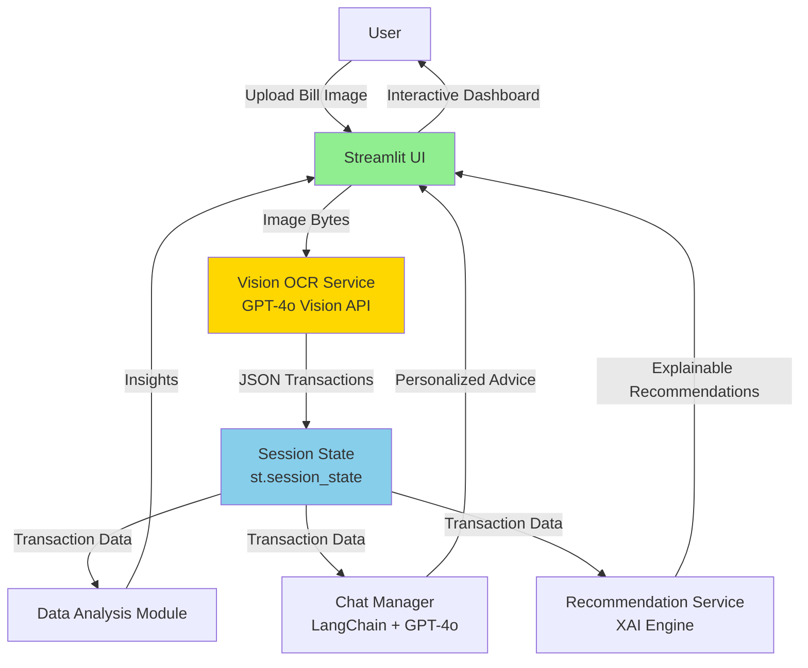

# WeFinance

English | **[中文](./README_zh-CN.md)**

> AI personal finance assistant. Take a photo of a bill and a vision LLM turns it into structured transactions, then WeFinance tracks your budget, flags unusual spending, and explains its advice.

[](https://wefinance-copilot.streamlit.app)
[](https://anna.partners/store/@calderbuild/wefinance?ref=github)
[](https://www.python.org/downloads/)
[](./LICENSE)
[](https://github.com/calderbuild/WeFinance)

**Award**: Excellence Award, 12th Nvidia Sky Hackathon.

## Try It

- **On Anna**: [WeFinance in the Anna App Store](https://anna.partners/store/@calderbuild/wefinance?ref=github). Scan a bill, track a monthly budget, and ask questions about your spending, inside the Anna desktop or cloud agent.
- **On the web**: [wefinance-copilot.streamlit.app](https://wefinance-copilot.streamlit.app), the Streamlit version with the full dashboard.

## What's New

- **Anna App Store listing**: WeFinance now ships as an Anna app (`anna_app/`) with three bundled tools: bill scanning, the finance advisor, and recommendations.
- **Overview tab**: budget health and spending trends at a glance, with a separate budget per currency instead of adding currencies together.
- **October 2026 redesign**: a receipt-style interface, a new icon, and a new store page.
- **Security hardening**: LLM output is escaped before rendering, scanned rows are rebuilt from known fields and validated, and receipt text is kept apart from the advisor's instructions.

---

## Overview

WeFinance uses GPT-4o Vision to read bills directly, then layers a conversational advisor, explainable investment suggestions, and anomaly detection on top of the extracted transactions.

On my test set of 10 bill images (72 transactions), every transaction was recognized correctly. See [OCR Recognition Accuracy](#ocr-recognition-accuracy) for the breakdown and how to rerun it.

### Key Capabilities

- **Bill recognition**: upload a bill photo and get structured transaction data in about 3 seconds
- **Multi-row screenshots**: payment app screenshots with 7-12 transactions are read row by row
- **Conversational advisor**: natural language Q&A with transaction context and budget awareness
- **Explainable recommendations**: investment suggestions with the decision reasoning shown
- **Anomaly detection**: unusual spending flagged with adaptive thresholds
- **Business cash-flow profile**: merchant concentration, spending trend, and anomaly summary for sole proprietors and freelancers
- **Imports**: images, PDF (pages rendered with pypdfium2), and Excel
- **Bilingual**: Simplified Chinese (default) and English, switchable in the sidebar

---

## The Problem

| Challenge | Traditional Approach | Limitation |
|-----------|---------------------|------------|
| **Manual data entry** | Type transactions from paper bills | Slow (5-10 min per bill), error-prone |
| **Fragmented tools** | Separate apps for tracking, analysis, advice | Context is lost between apps |
| **Black-box AI** | Robo-advisors without explanations | Hard to trust |
| **Late fraud detection** | Users find out after the fact | Money already lost |

---

## Technical Architecture

WeFinance has two front ends that share the same services:

- **Streamlit web app** (`app.py`, `pages/`, `modules/`, `services/`)
- **Anna app** (`anna_app/`): a bundled web UI plus three executa tools (`wefinance-ocr`, `wefinance-chat`, `wefinance-recommend`)

### System Overview



### Technology Stack

| Layer | Technology | Version |
|-------|-----------|---------|
| **Frontend** | Streamlit / Anna app bundle | 1.37+ |
| **Vision OCR** | GPT-4o Vision (any OpenAI-compatible endpoint) | - |
| **LLM** | GPT-4o | - |
| **Conversation** | LangChain | 0.2.10+ |
| **Data processing** | Pandas | 2.0+ |
| **Visualization** | Plotly | 5.18+ |
| **Environment** | Conda or pip | - |

---

## How It Works

### 1. From Local OCR to a Vision LLM

I started with PaddleOCR and a Chinese model. It could not read my synthetic test bills at all, and it needed about 200MB of local models. Switching to GPT-4o Vision removed the local models and the preprocessing step, and it read both the synthetic bills and real photos in the test set correctly.

Tradeoffs:
- Cost: about $0.01 per image
- Privacy: images are sent over HTTPS to the model provider and are not stored by WeFinance

### 2. Multi-row Bills

The first prompt often returned only the first transaction of a multi-row bill. The fix was in the shape of the output, not the code: the prompt now asks the model to count the rows first, then extract each one, and the transactions array must match that count.

```python
"""
Step 1: Count transactions (how many rows with independent amounts?)
Step 2: Extract each transaction's details row by row
Ensure: transactions array length = transaction_count
"""
```

With this prompt, payment app screenshots with 7-12 transactions are read row by row, with no logic changes.

### 3. Explainable Recommendations

**Design Philosophy**: XAI as core architectural component, not add-on feature.

**Hybrid Rule Engine + LLM Approach**:
```python
# Step 1: Rule Engine generates decision log
decision_log = {
    "risk_profile": "Conservative",
    "rejected_products": [
        {"name": "Stock Fund A", "reason": "Risk level (5) exceeds limit (2)"}
    ],
    "selected_products": [
        {"name": "Bond Fund B", "weight": 70%, "reason": "Highest return in low-risk category"}
    ]
}

# Step 2: LLM converts decision log to natural language
explanation = llm.generate(f"""
Explain why this portfolio was recommended:
{json.dumps(decision_log, indent=2)}

Requirements:
1. Use "Because... Therefore..." causal chains
2. Reference specific data (return rate, risk level)
3. Avoid jargon, use plain language
""")
```

**Why Hybrid?**
- **Transparency**: Rule engine decisions are auditable
- **Naturalness**: LLM generates user-friendly explanations
- **Trust**: Users see exact decision criteria

---

## OCR Recognition Accuracy

**Test set**: 10 bill images (3 synthetic, 7 real photos), 4-12 transactions per image, mixed categories (dining, shopping, transport).

| Image Type | Transactions | Recognized |
|-----------|--------------|------------|
| **Synthetic bills** (3) | 11 | 11 |
| **Real photos** (7) | 61 | 61 |
| **Total** | **72** | **72** |

This is a small test set, so treat it as a sanity check rather than a benchmark.

**Rerun it**:
```bash
python scripts/test_vision_ocr.py --show-details --dump-json
# Logs: artifacts/ocr_test_results.log
# JSON dumps: artifacts/ocr_results/*.json
```

---

## Getting Started

### Prerequisites

- Python 3.10+
- Conda (recommended) or pip
- OpenAI API key (or compatible endpoint)

### Installation

```bash
# Clone repository
git clone https://github.com/calderbuild/WeFinance.git
cd WeFinance

# Create conda environment (recommended)
conda env create -f environment.yml
conda activate wefinance

# Or use pip
pip install -r requirements.txt
```

### Configuration

```bash
# Copy environment template
cp .env.example .env

# Edit .env with your API credentials
# Required: OPENAI_API_KEY, OPENAI_BASE_URL, OPENAI_MODEL
```

Example `.env`:
```bash
OPENAI_API_KEY=sk-your-api-key-here
OPENAI_BASE_URL=https://api.openai.com/v1
OPENAI_MODEL=gpt-4o
LLM_PROVIDER=openai
TZ=Asia/Shanghai
```

### Run Application

```bash
streamlit run app.py
```

Application opens at: `http://localhost:8501`

### Language Switching

- Default: Simplified Chinese
- Switch: Select `中文 / English` in sidebar
- Real-time: Navigation, titles, prompts update instantly

---

## Development

### Testing

```bash
# Run all tests
pytest tests/ -v

# Specific test file
pytest tests/test_ocr_service.py -v

# Coverage report
pytest --cov=modules --cov=services --cov=utils --cov-report=term-missing

# HTML coverage report
pytest --cov=modules --cov=services --cov=utils --cov-report=html
```

### Code Quality

```bash
# Format code (required before commits)
black .

# Lint code
ruff check .
ruff check --fix .  # Auto-fix safe issues
```

### Vision OCR Testing

```bash
# Batch testing with metadata validation
python scripts/test_vision_ocr.py --show-details --dump-json
```

---

## Roadmap

### Done
- GPT-4o Vision bill recognition
- Conversational financial advisor
- Explainable investment recommendations
- Anomaly detection
- Bilingual support (zh_CN, en_US)
- PDF/Excel bill import
- Business cash-flow profile for sole proprietors and freelancers
- Anna app with Overview tab and per-currency monthly budgets

### Next
- [ ] Currency conversion and cross-currency reports (currencies are tracked separately today, not converted)
- [ ] Report export (PDF, Excel)
- [ ] Mobile-friendly Streamlit layout
- [ ] Batch bill processing API

### Later
- [ ] Banking API integration (Plaid, Teller)
- [ ] Recurring expense tracking and prediction
- [ ] Multi-user support with data isolation
- [ ] Cash-flow forecasting
- [ ] On-device OCR as a privacy-first option
- [ ] Open data export (OFX, QIF)

---

## Documentation

### Technical Guides

- **[Product Requirements (PRD v2.0)](./.claude/specs/wefinance-copilot/01-product-requirements.md)** - Feature specifications
- **[System Architecture](./.claude/specs/wefinance-copilot/02-system-architecture.md)** - Detailed architecture
- **[Sprint Planning](./.claude/specs/wefinance-copilot/03-sprint-plan.md)** - Development roadmap
- **[Deployment Guide](./DEPLOY.md)** - Streamlit Cloud + Docker + K8s
- **[Repository Guidelines](./AGENTS.md)** - Coding standards, testing
- **[Conda Environment Guide](./docs/CONDA_GUIDE.md)** - Environment management

### Developer Resources

- **[CLAUDE.md](./CLAUDE.md)** - Project instructions for Claude Code
- **[API Documentation](./.claude/specs/)** - Detailed API specs

---

## Contributing

Contributions are welcome! Here's how:

### Getting Started

1. Fork the repository
2. Create feature branch (`git checkout -b feature/amazing-feature`)
3. Make your changes
4. Test thoroughly (`pytest tests/ -v`)
5. Format code (`black .` and `ruff check --fix .`)
6. Commit (`git commit -m 'feat: add amazing feature'`)
7. Push to branch (`git push origin feature/amazing-feature`)
8. Open Pull Request

### Contribution Guidelines

- **Code Style**: PEP8 compliance (enforced by `black` and `ruff`)
- **Commit Messages**: Conventional commits (`type(scope): description`)
- **Testing**: Add tests for new features, maintain coverage
- **Documentation**: Update docs for API changes
- **Language**: English for code comments and documentation

### Priority Areas

High-impact contributions:

- **OCR Enhancements**: Support for receipts, invoices, bank statements
- **Multi-currency**: Currency detection and conversion
- **Privacy Features**: On-device OCR alternatives
- **Mobile UX**: Responsive design, touch optimization
- **Integration**: Banking API connectors (Plaid, Teller)
- **Testing**: Increase coverage to 90%+
- **Localization**: Additional language support (ja_JP, ko_KR, es_ES)

---

## Community & Support

- **Issues**: [GitHub Issues](https://github.com/calderbuild/WeFinance/issues)
- **Email**: johnrobertdestiny@gmail.com

### Join Our WeChat Community

Scan the QR code to join our WeChat group for discussions, support, and updates:

<div align="center">
  
  <p><em>QR code valid until December 12, 2025. Will be updated after expiration.</em></p>
</div>

**Can't scan the group QR code?** Add the maintainer's personal WeChat and request to join:

<div align="center">
  
  <p><em>WeChat ID: Destiny (Singapore)</em></p>
</div>

---

## License

This project is licensed under the MIT License - see [LICENSE](LICENSE) for details.

---

## Acknowledgments

- **OpenAI** - GPT-4o Vision API
- **Streamlit** - Rapid prototyping framework
- **LangChain** - Conversation management tools
- **Open Source Community** - Invaluable libraries and inspiration

---

## Star History

[](https://star-history.com/#calderbuild/WeFinance&Date)
