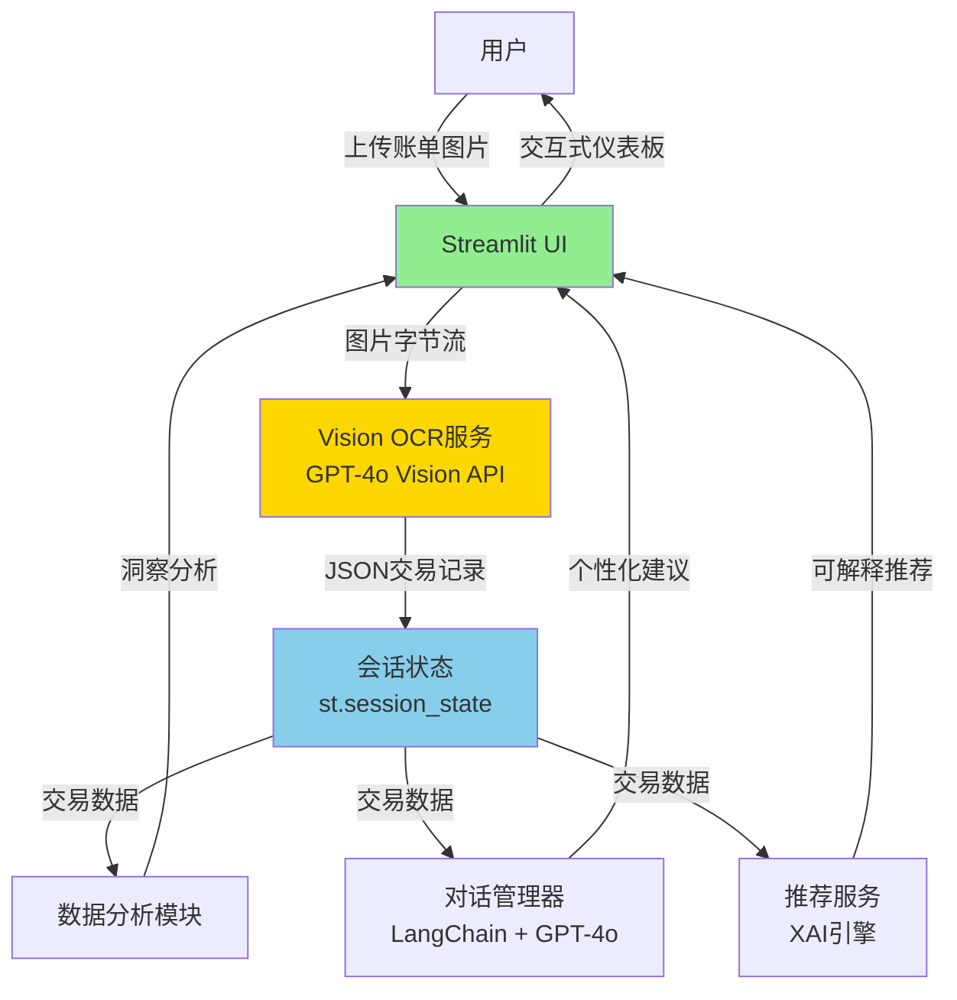

# WeFinance

**[English](./README.md)** | 中文

> AI 个人财务助手。拍一张账单，视觉大模型把它整理成结构化交易记录，WeFinance 再帮你管预算、提醒异常消费，并解释它给出的建议。

[](https://wefinance-copilot.streamlit.app)
[](https://anna.partners/store/@calderbuild/wefinance?ref=github-zh)
[](https://www.python.org/downloads/)
[](./LICENSE)
[](https://github.com/calderbuild/WeFinance)

**获奖**：第 12 届 Nvidia Sky Hackathon 优秀奖（Excellence Award）。

## 立即体验

- **在 Anna 上使用**：[Anna 应用商店里的 WeFinance](https://anna.partners/store/@calderbuild/wefinance?ref=github-zh)。拍账单记账、设月度预算、按真实消费提问，直接在 Anna 桌面端或云端 agent 里用。
- **网页版**：[wefinance-copilot.streamlit.app](https://wefinance-copilot.streamlit.app)，Streamlit 版本，带完整看板。

## 最新进展

- **上架 Anna 应用商店**：WeFinance 现在也是一个 Anna 应用（`anna_app/`），内置账单识别、财务顾问、投资推荐三个工具。
- **Overview 看板**：一眼看预算健康度和消费趋势，不同币种分别记预算，不再把不同币种直接相加。
- **2026 年 10 月改版**：小票风格的新界面、新图标和新的商店页面。
- **安全加固**：大模型输出在渲染前转义，识别出的交易行只按已知字段重建并校验，账单文字和顾问指令隔离。

---

## 项目概述

WeFinance 用 GPT-4o Vision 直接读账单，再在识别出的交易上叠加对话式财务顾问、可解释的投资建议和异常消费检测。

在我的 10 张账单（共 72 笔交易）测试集上，所有交易都识别正确。明细和复现方法见 [OCR 识别准确率](#ocr-识别准确率)。

### 核心能力

- **账单识别**：上传账单照片，约 3 秒得到结构化交易数据
- **多行截图**：支付 App 截图里的 7-12 笔交易逐行识别
- **对话式顾问**：带交易上下文和预算意识的自然语言问答
- **可解释推荐**：投资建议附带决策理由
- **异常检测**：自适应阈值提醒异常消费
- **经营流水画像**：面向个体户和自由职业者，查看交易对手集中度、收支趋势与异常摘要
- **多格式导入**：图片、PDF（用 pypdfium2 渲染）和 Excel
- **双语**：简体中文（默认）和英文，侧栏切换

---

## 问题背景

| 痛点 | 传统做法 | 局限 |
|------|---------|------|
| **手工录入** | 照着纸质账单手动输入 | 慢（每张 5-10 分钟），易出错 |
| **工具割裂** | 记账、分析、建议分散在不同 App | 上下文丢失 |
| **黑盒 AI** | 智能投顾不给解释 | 难以信任 |
| **事后才发现欺诈** | 用户事后才察觉 | 损失已经发生 |

---

## 技术架构

WeFinance 有两个前端，共用同一套服务：

- **Streamlit 网页版**（`app.py`、`pages/`、`modules/`、`services/`）
- **Anna 应用**（`anna_app/`）：内置网页界面，加上三个 executa 工具（`wefinance-ocr`、`wefinance-chat`、`wefinance-recommend`）

### 系统总览



### 技术栈

| 层 | 技术 | 版本 |
|----|------|------|
| **前端** | Streamlit / Anna 应用 | 1.37+ |
| **视觉识别** | GPT-4o Vision（任意 OpenAI 兼容接口） | - |
| **大模型** | GPT-4o | - |
| **对话管理** | LangChain | 0.2.10+ |
| **数据处理** | Pandas | 2.0+ |
| **可视化** | Plotly | 5.18+ |
| **环境** | Conda 或 pip | - |

---

## 实现原理

### 1. 从本地 OCR 换成视觉大模型

最开始用的是 PaddleOCR 加中文模型，它完全读不出我的合成测试账单，而且要带约 200MB 的本地模型。换成 GPT-4o Vision 后，本地模型和预处理步骤都去掉了，测试集里的合成账单和真实照片都能正确识别。

取舍：
- 成本：每张图约 0.01 美元
- 隐私：图片通过 HTTPS 发给模型服务商，WeFinance 不保存

### 2. 多行账单

最初的提示词常常只返回多行账单的第一笔。问题出在输出结构上，而不是代码：现在提示词要求模型先数有几行，再逐行提取，交易数组长度必须等于行数。

```python
"""
Step 1: Count transactions (how many rows with independent amounts?)
Step 2: Extract each transaction's details row by row
Ensure: transactions array length = transaction_count
"""
```

用这个提示词，支付 App 截图里的 7-12 笔交易能逐行识别，代码逻辑没有改动。

### 3. 可解释推荐

**设计哲学**：XAI作为核心架构组件，而非附加功能。

**规则引擎 + LLM混合方案**：
```python
# 步骤1: 规则引擎生成决策日志
decision_log = {
    "risk_profile": "保守型",
    "rejected_products": [
        {"name": "股票基金A", "reason": "风险等级(5)超过上限(2)"}
    ],
    "selected_products": [
        {"name": "债券基金B", "weight": 70%, "reason": "低风险类别中收益率最高"}
    ]
}

# 步骤2: LLM将决策日志转换为自然语言
explanation = llm.generate(f"""
向用户解释为什么推荐这个投资组合:
{json.dumps(decision_log, indent=2)}

要求:
1. 使用"因为...所以..."因果链
2. 引用具体数据（收益率、风险等级）
3. 避免金融术语，使用通俗语言
""")
```

**为什么采用混合方案？**
- **透明度**：规则引擎决策可审计
- **自然性**：LLM生成用户友好的解释
- **信任度**：用户看到确切的决策标准

---

## OCR 识别准确率

**测试集**：10 张账单图片（3 张合成、7 张真实照片），每张 4-12 笔交易，类别混合（餐饮、购物、交通）。

| 图片类型 | 交易数 | 识别正确 |
|---------|-------|---------|
| **合成账单**（3 张） | 11 | 11 |
| **真实照片**（7 张） | 61 | 61 |
| **合计** | **72** | **72** |

测试集很小，把它当作自检，而不是基准测试。

**复现**：
```bash
python scripts/test_vision_ocr.py --show-details --dump-json
# 日志: artifacts/ocr_test_results.log
# JSON 结果: artifacts/ocr_results/*.json
```

---

## 快速开始

### 环境要求

- Python 3.10+
- Conda（推荐）或 pip
- OpenAI API密钥（或兼容端点）

### 安装

```bash
# 克隆仓库
git clone https://github.com/calderbuild/WeFinance.git
cd WeFinance

# 创建conda环境（推荐）
conda env create -f environment.yml
conda activate wefinance

# 或使用pip
pip install -r requirements.txt
```

### 配置

```bash
# 复制环境变量模板
cp .env.example .env

# 编辑.env文件，填入你的API凭证
# 必需: OPENAI_API_KEY, OPENAI_BASE_URL, OPENAI_MODEL
```

`.env` 配置示例:
```bash
OPENAI_API_KEY=sk-your-api-key-here
OPENAI_BASE_URL=https://api.openai.com/v1
OPENAI_MODEL=gpt-4o
LLM_PROVIDER=openai
TZ=Asia/Shanghai
```

### 运行应用

```bash
streamlit run app.py
```

应用将在浏览器中打开：`http://localhost:8501`

### 界面语言切换

- 默认语言：简体中文
- 切换方式：在侧边栏下拉框选择 `中文 / English`
- 实时生效：导航、标题、提示即时更新

---

## 开发

### 测试

```bash
# 运行所有测试
pytest tests/ -v

# 运行特定测试文件
pytest tests/test_ocr_service.py -v

# 生成覆盖率报告
pytest --cov=modules --cov=services --cov=utils --cov-report=term-missing

# 生成HTML覆盖率报告
pytest --cov=modules --cov=services --cov=utils --cov-report=html
```

### 代码质量

```bash
# 格式化代码（提交前必需）
black .

# 代码检查
ruff check .
ruff check --fix .  # 自动修复安全问题
```

### Vision OCR测试

```bash
# 批量测试（带元数据验证）
python scripts/test_vision_ocr.py --show-details --dump-json
```

---

## 路线图

### 已完成
- GPT-4o Vision 账单识别
- 对话式财务顾问
- 可解释投资推荐
- 异常消费检测
- 双语支持（zh_CN、en_US）
- PDF/Excel 账单导入
- 面向个体户和自由职业者的经营流水画像
- Anna 应用：Overview 看板和按币种的月度预算

### 下一步
- [ ] 汇率换算和跨币种报表（目前各币种分开记，不做换算）
- [ ] 报表导出（PDF、Excel）
- [ ] Streamlit 版移动端适配
- [ ] 批量账单处理 API

### 更远
- [ ] 银行 API 对接（Plaid、Teller）
- [ ] 周期性支出追踪与预测
- [ ] 多用户与数据隔离
- [ ] 现金流预测
- [ ] 设备端 OCR，作为隐私优先的选项
- [ ] 开放数据导出（OFX、QIF）

---

## 技术文档

### 技术指南

- **[产品需求文档 (PRD v2.0)](./.claude/specs/wefinance-copilot/01-product-requirements.md)** - 功能规格说明
- **[系统架构设计](./.claude/specs/wefinance-copilot/02-system-architecture.md)** - 详细架构
- **[Sprint规划](./.claude/specs/wefinance-copilot/03-sprint-plan.md)** - 开发路线图
- **[部署指南](./DEPLOY.md)** - Streamlit Cloud + Docker + K8s方案
- **[仓库规范](./AGENTS.md)** - 编码标准、测试
- **[Conda环境管理指南](./docs/CONDA_GUIDE.md)** - 环境管理

### 开发者资源

- **[CLAUDE.md](./CLAUDE.md)** - Claude Code项目说明
- **[API文档](./.claude/specs/)** - 详细API规范

---

## 贡献指南

欢迎贡献！参与方式：

### 开始贡献

1. Fork本仓库
2. 创建功能分支 (`git checkout -b feature/amazing-feature`)
3. 进行修改
4. 充分测试 (`pytest tests/ -v`)
5. 格式化代码 (`black .` 和 `ruff check --fix .`)
6. 提交修改 (`git commit -m 'feat: add amazing feature'`)
7. 推送到分支 (`git push origin feature/amazing-feature`)
8. 创建Pull Request

### 贡献规范

- **代码风格**：遵循PEP8（由`black`和`ruff`强制执行）
- **提交信息**：使用约定式提交格式 (`type(scope): description`)
- **测试**：为新功能添加测试，保持覆盖率
- **文档**：更新API变更的文档
- **语言**：代码注释和文档使用英文

### 优先贡献方向

高影响力贡献：

- **OCR增强**：支持收据、发票、银行对账单
- **多币种**：货币检测和转换
- **隐私功能**：设备端OCR替代方案
- **移动端UX**：响应式设计，触控优化
- **集成**：银行API连接器（Plaid, Teller）
- **测试**：将覆盖率提升至90%+
- **本地化**：额外语言支持（ja_JP, ko_KR, es_ES）

---

## 社区与支持

- **问题反馈**：[GitHub Issues](https://github.com/calderbuild/WeFinance/issues)
- **邮箱**：johnrobertdestiny@gmail.com

### 加入微信交流群

扫码加入微信群，获取技术支持、参与讨论、了解最新动态：

<div align="center">
  
  <p><em>二维码有效期至2025年12月12日，过期后将更新</em></p>
</div>

**群二维码过期？** 添加维护者个人微信，备注"WeFinance"申请入群：

<div align="center">
  
  <p><em>微信号：Destiny（新加坡）</em></p>
</div>

---

## 许可证

本项目采用MIT许可证 - 详见[LICENSE](LICENSE)文件

---

## 致谢

- **OpenAI** - GPT-4o Vision API
- **Streamlit** - 快速原型开发框架
- **LangChain** - 对话管理工具
- **开源社区** - 宝贵的库和灵感

---

## Star历史

[](https://star-history.com/#calderbuild/WeFinance&Date)
